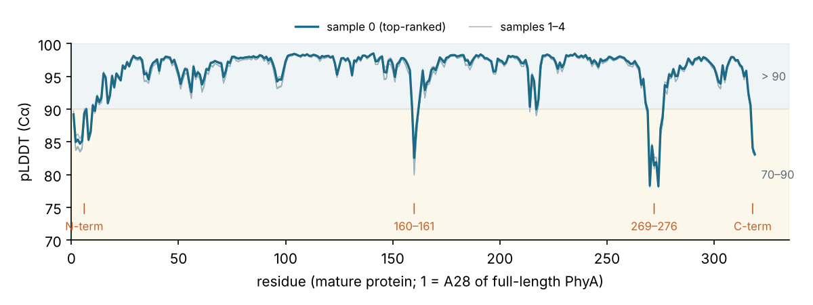

*Activity 03 · 2026-10-30*

# Predict the PhyA structure on Colab

**Mol-1 predicted the 319-residue mature *Selenomonas ruminantium* phytase on a Colab T4 GPU (pTM 0.96, mean pLDDT about 95), after four failures were worked through: a hidden error, a missing `ninja`, a 502 from the MSA server and a LayerNorm build without T4 code.**

## Aim

The user asked whether Mol-1 could predict protein structures, then supplied a 346-residue sequence and asked for it to be run. The protein was later identified as phytase PhyA (UniProt Q7WUJ1). Done meant CIF structures and confidence scores for that sequence.

Two constraints shaped everything. The cloud container had no GPU, and its network policy blocked both the weights host and the MSA server. The user chose Google Colab instead, which meant the work became writing a notebook, then diagnosing failures from error output pasted back into the chat. No command could be run on Colab directly.

## Tools

| Tool | Version | Used for |
| --- | --- | --- |
| Google Colab, Tesla T4 | compute capability 7.5, 16 GB | Running the prediction |
| PyTorch | 2.11.0+cu130 (CUDA 13.0, nvcc 13.0) | Installed by `pip install -e ".[cuda]"` |
| Mol-1 | 1.0.0 | `mol msa` and `mol pred` |
| ColabFold MMseqs2 server | public API | Protein MSA search |
| ninja | from PyPI | Build tool PyTorch needs to compile the fused LayerNorm |
| py3Dmol | from PyPI | 3D view in the notebook, coloured by pLDDT |

## Process

### 1. Trying the cloud container first

The first check covered the GPU, memory and the three hosts the run needs.

*Environment check, trimmed*

```bash
nvidia-smi; nproc; free -g
curl -sS -o /dev/null -w "%{http_code}\n" https://api.colabfold.com/
curl -sS -o /dev/null -w "%{http_code}\n" -I https://mol-1-release.oss-cn-shanghai.aliyuncs.com/checkpoint/mol-1-base.pt
```

*Output: `nvidia-smi: command not found`; 4 CPUs, 15 GB RAM; both hosts returned `CONNECT tunnel failed, response 403`. The input JSON was still written, and the user was told how to allow the two hosts.*

### 2. A Colab notebook

The notebook read the driver's CUDA version to choose between the `cuda` and `cuda12` extras, then cloned and installed Mol-1. It downloaded the reference data and weights, wrote the job JSON, ran `mol pred`, and showed and zipped the results.

### 3. Failure 1: an error that hid itself

The first report was a `FileNotFoundError` in the viewer cell: no `sample_0.cif`. The path matched the dumper's layout (`<out>/<name>/seed_<seed>/predictions`), so the prediction itself had failed earlier. Shell lines starting with `!` do not stop "Run all" when they fail. Every command was moved into a helper that raises an error instead.

*The helper added to cell 1*

```python
def run(cmd):
    p = subprocess.run(cmd, shell=True)
    if p.returncode != 0:
        raise RuntimeError(f"Command failed (exit {p.returncode}): {cmd}")
```

### 4. Failure 2: no ninja

The real error came from Mol-1's first-use compile of its CUDA LayerNorm extension.

*Output pasted by the user, trimmed*

```text
RuntimeError: Ninja is required to load C++ extensions (pip install ninja to get it)
RuntimeError: Unable to load or build the Fast LayerNorm CUDA extension for sm75 with torch 2.11.0+cu130
```

`pip install ninja` fixed it. The extension then compiled in about 4 minutes and the checkpoint loaded (576.79 M parameters). Nothing in `pyproject.toml` installs `ninja`.

### 5. Failure 3: the MSA server returned 502

*Output pasted by the user, trimmed*

```text
ERROR ... Server didn't reply with json: <title>502 Bad Gateway</title>
Exception: MMseqs2 API is giving errors. Please confirm your input is a valid protein sequence.
AssertionError: msa search failed
```

Reading `colab_request_utils.py` showed why it stopped at once: a non-JSON reply becomes `status: ERROR`, which raises immediately. Only `UNKNOWN` and `RATELIMIT` are retried. The message about an invalid sequence is misleading. The MSA step was split into its own cell with a retry loop. `mol msa` writes `<name>-update-msa.json` with the MSA paths filled in, so `mol pred` on that file skips the search.

*Cell 5a, trimmed*

```python
for attempt in range(1, 11):
    p = subprocess.run(f"mol msa -i /content/{NAME}.json -o /content/msa", shell=True)
    if p.returncode == 0 and os.path.exists(msa_json):
        break
    time.sleep(180)
```

### 6. Failure 4: no kernel image for the T4

With the MSA in place (5,008 sequences, 319 tokens), the model failed on its first step with `CUDA error: no kernel image is available for execution on the device`. The traceback pointed at `torch.sigmoid`, but CUDA reports errors late, so the call before it was the suspect. The compile line from failure 2 had shown `-gencode` flags only from `compute_80` upward. The cause was in the build script:

*`mol/model/layer_norm/torch_ext_compile.py`, the architectures it builds for*

```python
_wanted = [
    ("70", "70"),
    ("80", "80"),
    ("86", "86"),
    ...
```

The T4 is architecture 75, which is not in the list, and CUDA 13's `nvcc` no longer offers `compute_70`. So the extension contained no code the T4 could run. The workaround was `LAYERNORM_TYPE=torch`, which uses PyTorch's own LayerNorm.



*Figure 1 — Where each failure struck in the run, and what got past it*

> Each red mark is a run that ended there; the blue line under it is what got past it. The first and third failures are Mol-1 defects that will hit any fresh Colab T4 user. The second is outside Mol-1's control, though its handling of the error (no retry, a misleading message) is not.

### 7. A stale error report

The next report repeated the "no kernel image" traceback, now read from `output/ERR/`. That raised the possibility that PyTorch itself lacked T4 support. One cell settled it:

*Diagnostic cell, and its output*

```python
!ls -l --time-style=+%H:%M:%S /content/output/ERR/
print(torch.__version__, torch.cuda.get_device_capability(), torch.cuda.get_arch_list())
print(torch.sigmoid(torch.ones(3, device="cuda")))
---
-rw-r--r-- 1 root root 9000 22:35:44 my_protein.txt
2.11.0+cu130 (7, 5) ['sm_75', 'sm_80', 'sm_86', 'sm_90', 'sm_100', 'sm_120']
tensor([0.7311, 0.7311, 0.7311], device='cuda:0')
```

PyTorch ran fine on the T4. The report's timestamp, 22:35:44, matched the failed run from before the workaround, so `mol pred` had simply not been rerun. After a rerun, the prediction finished.

## Results

Five structures and their confidence files were produced for the mature protein: 319 residues, starting `AKAPEQ`. The first 27 residues, a predicted signal peptide, were absent from the JSON that ran; Mol-1 does not trim sequences itself.



*Figure 2 — Per-residue pLDDT (Cα) for all five samples*

> Almost the whole chain sits above 90, which counts as very high confidence. The four dips are the N-terminus, a loop at 160–161, a charged surface loop at 269–276 (`KTKDKDS`, the lowest point at 78) and the last two residues. The grey lines for samples 1–4 nearly overlap the blue one, so the samples agree on where the model is unsure, not only on the fold.

- pLDDT 94.4–94.9 and pTM 0.964–0.965 across samples; 296 of 319 Cα atoms above 90 in sample 0, none below 70.
- Samples lie 1.0–1.6 Å Cα RMSD from sample 0 (RMSD: root-mean-square distance after superposition).
- All five `ranking_score` values are 0.193. That is expected for one chain, because the score mostly weighs ipTM, which is 0 without an interface.

### Limits and what was left

- The notebook's final version was assembled from fixes that were each tested on Colab separately, but it was never run top to bottom on a fresh runtime.
- The T4 ran in FP32 with PyTorch kernels and PyTorch's LayerNorm. Run time was not recorded.
- The three Mol-1 defects (no `ninja` dependency, no retry on server errors, no `sm_75` in the LayerNorm build) were reported but not fixed in the repository.
