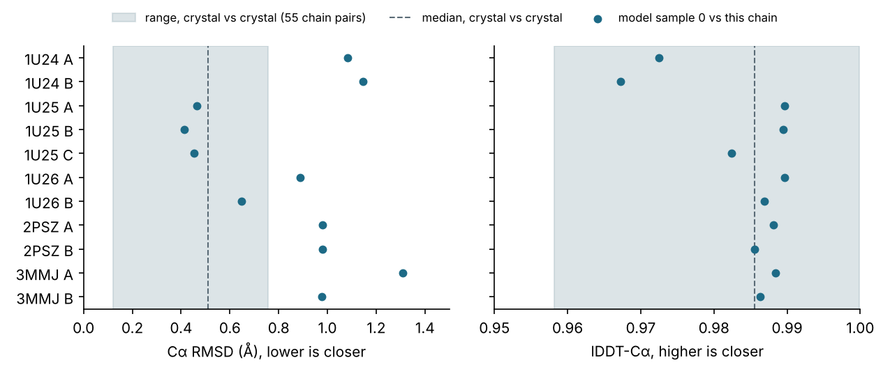
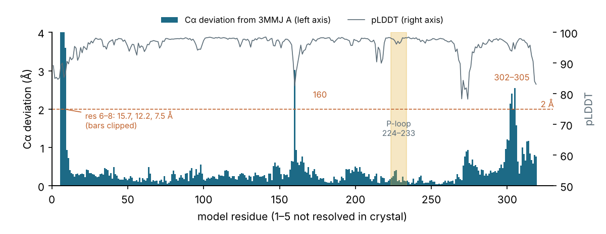

*Activity 04 · 2026-10-30*

# Compare the prediction with the PhyA crystal structures

**Against 11 chains from five crystal structures, the Mol-1 model scored a median 0.98 Å Cα RMSD and 0.987 lDDT, as close as the crystals are to one another, with the catalytic P-loop within 0.54 Å all-atom; the structures were probably in its training data.**

## Aim

After activity 03, the user identified the protein as Q7WUJ1, the PTP-like phytase PhyA of *Selenomonas ruminantium*. They asked for a comparison with its crystal structure and a judgement of the prediction's quality.

Done meant standard agreement scores against the experimental structures, a statement of where the model deviates, and a verdict with a fair reference point. A fixed threshold such as "RMSD under 2 Å" ignores how much the protein itself varies between crystals, so the crystals were also compared with each other. The PDB was blocked from the container, so the user uploaded five entries as PDB files.

## Tools

| Tool | Version | Used for |
| --- | --- | --- |
| gemmi | 0.7.5 | Reading CIF and PDB files; mapping modified residues (selenomethionine, MSE → M) |
| Biopython `PairwiseAligner` | 1.88 | Sequence alignment from model residues to crystal residues |
| NumPy | 2.5.4 | Kabsch superposition, RMSD, lDDT, TM-score and GDT_TS |
| matplotlib | 3.11.2 | Figures for this log |
| `compare_crystal.py` | written in this session | The comparison itself |

## Process

### 1. Getting the reference structures

The first plan was to fetch every PDB entry for Q7WUJ1 from RCSB automatically. The container could not reach the PDB:

*Access check, trimmed*

```bash
curl -sS -o /dev/null -w "%{http_code} $u\n" --max-time 20 "$u"   # for files.rcsb.org, rest.uniprot.org, www.ebi.ac.uk
```

*Output: `CONNECT tunnel failed, response 403` for every host.*

The script kept its RCSB search path for use on Colab, and gained a `--local` mode for files on disk. While the script was being tested, the user uploaded 1U24, 1U25, 1U26, 2PSZ and 3MMJ. Their headers showed what each one is: 1U24 has no ligand (2.0 Å); 1U25 and 1U26 hold a sulfated phytate (2.5 Å); 2PSZ was crystallised at low ionic strength (2.0 Å); 3MMJ is the catalytic-site mutant C252S with phytate bound (1.6 Å). The expression tags and MSE residues in the headers ruled out matching residues by number.

### 2. Matching residues and scoring

Each crystal chain was aligned to the model by sequence, which absorbs tags, numbering offsets and point mutations. Chains below 90% identity or 50 matched residues are skipped.

*Core of `compare()` in `compare_crystal.py`, trimmed*

```python
pairs = align_map(m_seq, c_seq)
P = np.array([m_res[i][1]["CA"] for i in mi]); Q = np.array([c_res[j][1]["CA"] for j in ci])
R, t = kabsch(P, Q)
r = dict(ca_rmsd=rmsd(P @ R + t, Q), tm=tm_score(P, Q, len(c_seq)),
         gdt_ts=gdt_ts(P, Q), lddt_ca=lddt(P, Q)[0], ...)
```

Four scores were used. Cα RMSD measures distance after one global superposition, so a single misplaced tail inflates it. TM-score (0–1; above 0.5 means the same fold) and GDT_TS (0–100) emphasise the well-placed core. lDDT (0–1) compares interatomic distances and needs no superposition. TM-score and GDT_TS were implemented here rather than taken from TM-align or LGA.

The script was first tested on predicted samples standing in for crystals. A copy of sample 1 with 10 residues removed, MSE substituted for methionine and numbering shifted by 27 aligned 309 residues at 0.17 Å, confirming the matching. One fix came out of this: Biopython's `seq1` maps MSE to X, so one-letter codes were taken from gemmi instead.

*The run against the uploaded files, and part of its output*

```bash
python compare_crystal.py results/output/my_protein/seed_101/predictions --local xtal/*.pdb
---
entry    res(A) chain  match  CA-RMSD  allatom     TM  GDT_TS  lDDT-CA   lDDT
1U24       2.00     A    313     1.08     1.38  0.982    97.8    0.972  0.894
1U25       2.50     B    311     0.41     1.08  0.993    99.8    0.989  0.901
3MMJ       1.60     A    314     1.31     1.51  0.988    98.2    0.988  0.916
P-loop HCEAGVGRTT (model residues 224-233): CA RMSD 0.24 A, all-atom RMSD 0.54 A
```

### 3. A baseline from the crystals themselves

The same functions compared all 55 pairs of the 11 crystal chains. That gives the spread to expect between two experimental structures of this protein.



*Figure 1 — Model vs each crystal chain (blue dots), against the spread between crystal chains (grey band)*

> Right panel: every blue dot lies inside the grey band, so by lDDT the model is as close to each crystal as the crystals are to each other (median 0.987 vs 0.986). Left panel: by RMSD, the 1U25 chains (0.41–0.46 Å) fall inside the crystal range of 0.12–0.76 Å. The others sit 0.1–0.6 Å beyond it. The two 1U24 chains are the weakest by both scores; 1U24 is also the most distinct crystal, at 0.27–0.67 Å from the others.

### 4. Where the model and crystal disagree



*Figure 2 — Per-residue Cα deviation from 3MMJ chain A (bars), with the model's pLDDT (line)*

> Nearly all bars are under 0.5 Å. Three places exceed 2 Å. First, N-terminal residues 6–8, at 15.7, 12.2 and 7.5 Å: the tail points a different way, next to five residues the crystal does not resolve, and these few residues alone raise the global RMSD. Second, residue 160, at the tip of a loop the model already scored lower. Third, the 302–305 turn (`DGYQ`). The P-loop (shaded) is among the flattest regions, even though 3MMJ carries the C252S mutation (model residue 225) and has phytate bound.

## Results

- Against 11 chains: median Cα RMSD 0.98 Å (range 0.41–1.31), TM-score 0.98–0.995, GDT_TS 97–100, lDDT-Cα median 0.987. Crystal-vs-crystal: 0.51 Å and 0.986.
- Against 3MMJ A (1.6 Å, the highest resolution): 95.2% of Cα within 1 Å, 97.1% within 2 Å; all-atom lDDT 0.92.
- Active site: the `HCEAGVGRTT` P-loop deviates 0.24 Å on Cα and 0.54 Å on all atoms.
- Calibration: mean pLDDT/100 was 0.961 against a measured lDDT of 0.988, so the model slightly underestimated its accuracy. Per residue, pLDDT and lDDT correlate only weakly (r = 0.39), because nearly everything is accurate.
- Verdict: near-experimental accuracy for the fold and the active site. The errors are confined to flexible surface segments.

### Limits and what was left

- Not a blind test. These entries were released 2004–2010 and Mol-1 derives from Protenix, which trains on the PDB, so the model has very likely seen this protein. A fair test needs a structure released after its training cutoff, which the repository does not state.
- TM-score and GDT_TS come from a local implementation, so expect small differences from TM-align and LGA. lDDT ignores stereochemistry checks.
- Only five of the PDB entries for Q7WUJ1 were compared, the ones uploaded. Ligands were not compared, because the model was predicted without them.
